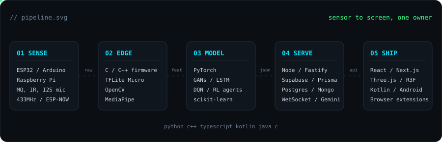
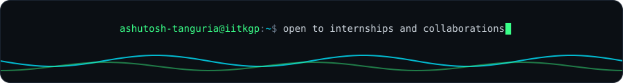

<div align="center">
  
</div>

<div align="center">
  <a href="https://portfolio-ashutosh-t.netlify.app/"></a>
  <a href="https://www.linkedin.com/in/ashutosh-tanguria/"></a>
  <a href="mailto:ashutosh.16748@gmail.com"></a>
</div>

<br/>

```yaml
name:       Ashutosh Tanguria
degree:     B.Tech, Biotechnology and Biochemical Engineering, IIT Kharagpur (2029)
societies:  ProDex (robotics, IoT, AI, embedded systems) | CGS (Computer Graphics Society), Senior Web Developer
focus:      full-stack, embedded systems, machine learning
approach:   design the whole pipeline first, then build each stage from first principles
```

```text
now         BlinkSafe nodes, StudyOS, browser extensions for theming college ERP and government websites
learning    React internals (Suspense, lazy loading), CRDT-based sync
open to     internships in software engineering, embedded systems and ML
```

<br/>

<div align="center">
  
</div>

<br/>

<table>
<tr><td><code>lang</code></td><td></td></tr>
<tr><td><code>web</code></td><td></td></tr>
<tr><td><code>backend</code></td><td> </td></tr>
<tr><td><code>mobile</code></td><td></td></tr>
<tr><td><code>ml / cv</code></td><td> </td></tr>
<tr><td><code>embedded</code></td><td> </td></tr>
<tr><td><code>tools</code></td><td></td></tr>
</table>

<br/>

| build | what it is | stack |
|---|---|---|
| [**BlinkSafe**](https://github.com/ashutosh-tanguria/BlinkSafe) | multi-node safety alerts for hard-of-hearing users: sound classification on-device, RF link to a vibration wristband | ESP32, TFLite Micro, 433MHz RF |
| **Fire Detection and Suppression** | multi-sensor threshold logic driving a pump and buzzer, with real-time Telegram alerts | ESP32, C++, Python |
| [**StudyOS**](https://github.com/ashutosh-tanguria/StudyOS) | personalized learning OS with a real-time Gemini Live voice companion | Next.js 16, Prisma, PostgreSQL, WebSocket |
| **Hearth Radar** | real-time social platform: live chat, rooms, presence, anonymous auth with RLS, PostGIS counts | Next.js, Supabase, Zustand |
| [**Collab-Code-Editor**](https://github.com/ashutosh-tanguria/Collab-Code-Editor) | multi-user collaborative coding and chat | WebSocket, Node.js |
| [**DevDeck**](https://github.com/ashutosh-tanguria/DevDeck) | developer dashboard: GitHub viewer, weather, Pomodoro, project board | Next.js 16 |
| **RL Game Agents** | Snake, Ping Pong and Chrome Dino agents with custom reward design | PyTorch, DQN |
| **GAN Image Generation** | generator and discriminator trained on GPU, tuned for stability | PyTorch, Colab |
| **3D Web Experience** | first-person office scene with collision, animated doors, in-scene video | Next.js, React Three Fiber |
| **Browser Extensions** | theming and layout engine for college ERP and government websites, plus a color-remap theme extension | Chrome, Firefox, CSS injection |
| **Campus Events Dashboard** | events and notices portal with pagination, dark mode and URL routing | Node, Express, React, Vite |
| **Android Notification App** | native app that delivers notifications to the user | Kotlin |

<br/>

<div align="center">
  
  
</div>

<div align="center">
  
</div>

<br/>

<div align="center">
  <picture>
    <source media="(prefers-color-scheme: dark)" srcset="https://raw.githubusercontent.com/ashutosh-tanguria/ashutosh-tanguria/output/github-snake-dark.svg" />
    
  </picture>
</div>

<br/>

<div align="center">
  
</div>